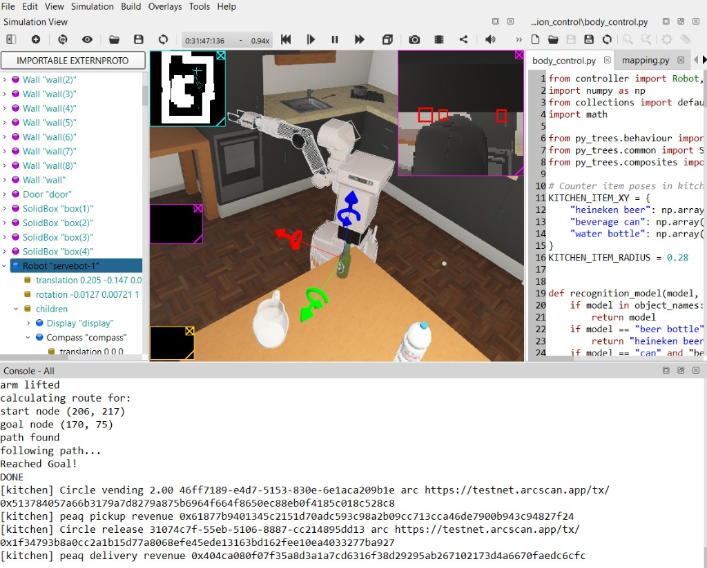
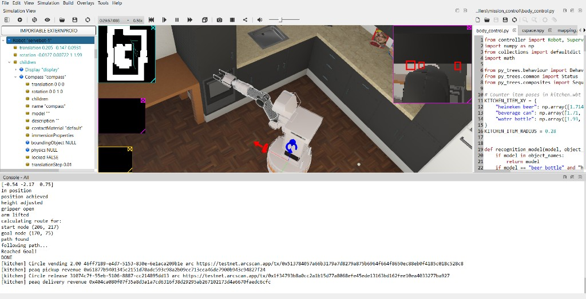
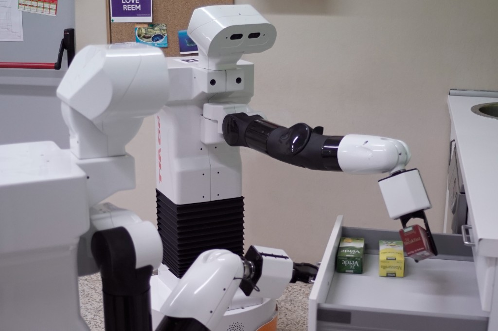
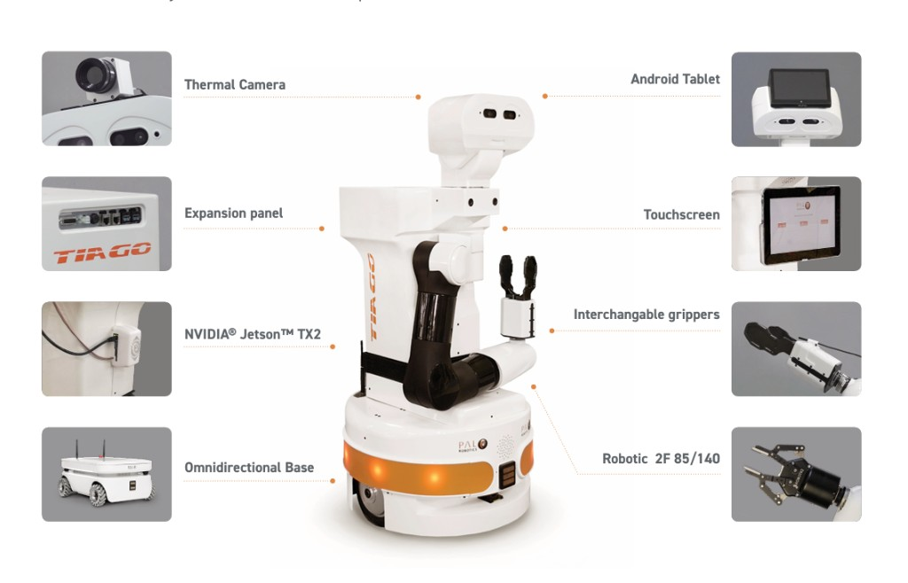
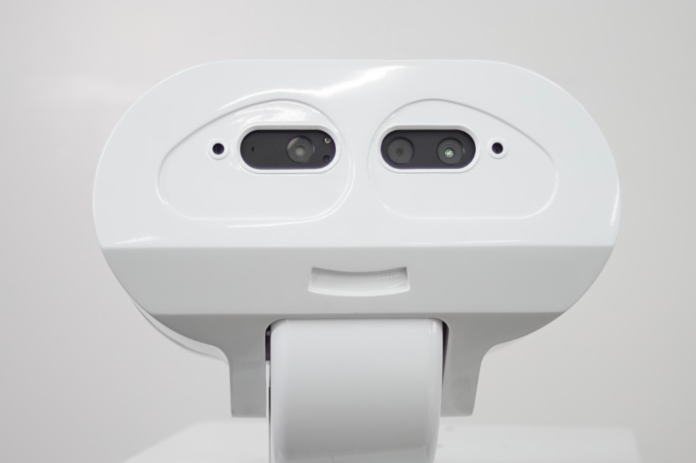
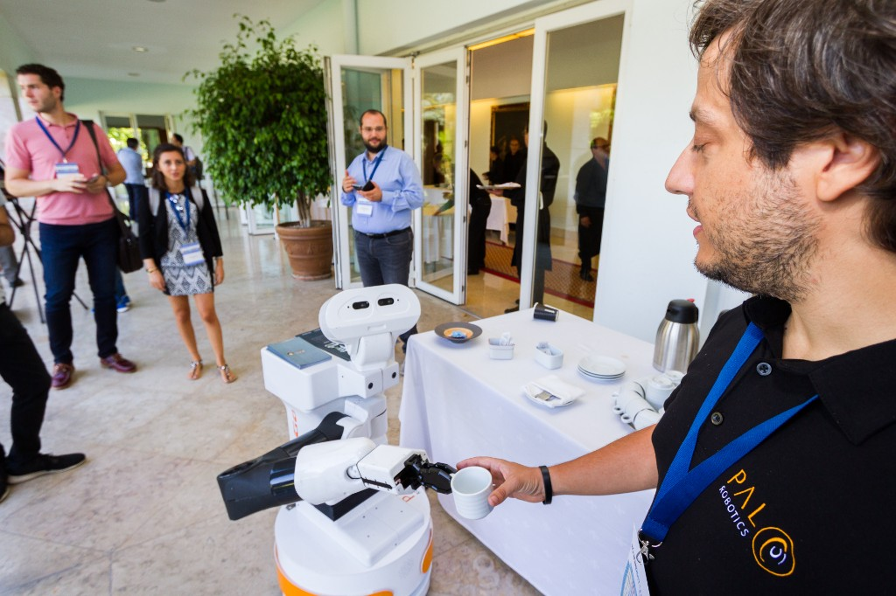
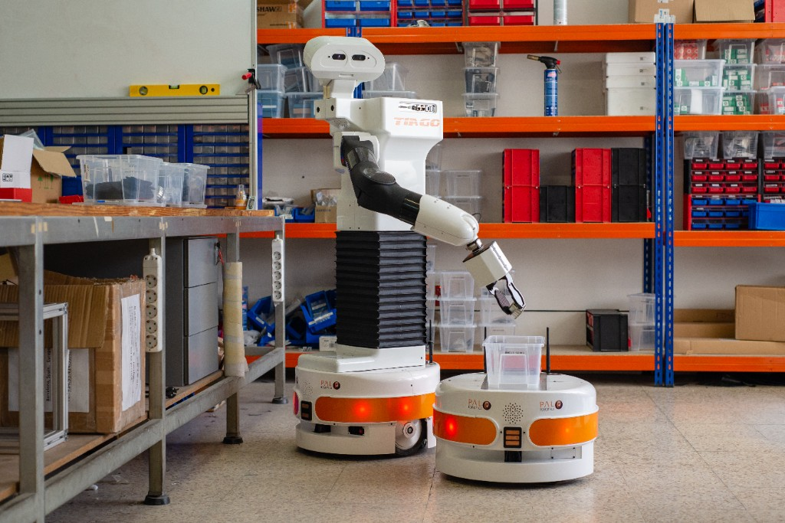
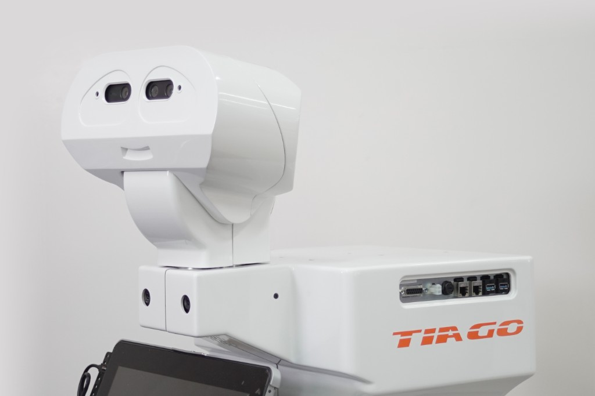

# Butler

**The robot that gets paid when the work is done.**

Butler is a hotel service robot with a financial layer built in.

A guest orders a coffee. Butler collects it from the kitchen counter and brings it to the room. The moment the order goes in, the guest’s USDC is locked in escrow, where it stays until delivery is confirmed onchain. Once confirmed, the payment is released.

Butler also holds a public identity on the peaq network, so the record names the exact machine that did the work: one specific robot with a verifiable identity.

Everything runs on its own. Payment settles automatically, the record writes itself, and the receipt is public for anyone to see. The robot delivered, and the robot got paid.

| | |
|---|---|
| **Builder** | Bleyle Osewe · [Bennybleylle09@gmail.com](mailto:Bennybleylle09@gmail.com) · 0705297628 |
| **Community** | [Web3 Clubs Kenya](https://web3clubs.xyz) |
| **Notion** | [Project Details](https://www.notion.so/Project-Details-3fbe6f3c0667802ca6e1f4060b445d87) |
| **Long-form pitch** | [`docs/Butler_Investor_Pitch.md`](docs/Butler_Investor_Pitch.md) |

---

## One-minute story

The demo bundle is **heineken beer, beverage can, and water bottle** for **6.00 USDC**. **Circle** holds the USDC; **Arc** escrow locks it on order and releases when delivery is confirmed onchain. **peaq** names the exact machine on a public record.

**servebot-1** (PAL **TIAGo** in Webots) runs `mission_control`; the kitchen is paid **2.00 USDC** on heineken pickup; the rest splits on delivery. No front desk. No invoice.

| Surface | URL |
|---------|-----|
| **Landing** (this story on the web) | [`apps/landing`](apps/landing) → http://localhost:3002 |
| **Guest order** | [`apps/hotel-ui`](apps/hotel-ui) → http://localhost:3001 |
| **How to run it** | [`docs/MANUAL_RUN_GUIDE.md`](docs/MANUAL_RUN_GUIDE.md) |

Partners on the landing page: **peaq · Circle · Arc · Webots · Web3 Clubs Kenya**.

---

## Video

**Kitchen simulation** — `servebot-1` in Webots `kitchen.wbt` (same run as the landing hero):

https://github.com/user-attachments/assets/bf5c0f22-95cb-4b4d-a137-0712223ad7fe

---

## Screenshots

### Live Webots run (settlement in the console)

Drinks on the kitchen table after delivery, with Circle / Arc / peaq lines in the Webots console:



`servebot-1` at the counter during the run (occupancy map, head camera, peaq mark on the base):



### Robot and scene

| Scene | Image |
|-------|--------|
| Kitchen pickup |  |
| Platform · servebot-1 |  |
| Head cameras (pickup / delivery proof) |  |
| Hospitality counter |  |
| Fleet / workshop |  |
| Machine identity (expansion panel) |  |
| Hackathon / venue | [`proposals/images/servebot-kitchen-simulation.jpg`](proposals/images/servebot-kitchen-simulation.jpg) · [`simulated-hotel-kitchen.jpg`](proposals/images/simulated-hotel-kitchen.jpg) |

Run **[hotel-ui](apps/hotel-ui)** locally for the guest order screen; Webots console shows Circle + peaq settler lines during Play.

---

## Why Butler (problem)

- **Guest:** Hard to see that delivery happened and that payment matched the job.
- **Hotel:** Manual trails between kitchen, room, and staff.
- **Robot / RaaS:** Flat leases hide premium skills; pay-per-task is hard to enforce.
- **Kenya hospitality:** ~**7.9 million** visitors in 2025, about **$3.8B**, **1,000+** accredited hotels—a high-frequency delivery environment with mostly manual settlement.

---

## Tameion / Circle agent fit

The hackathon asks for an agent that **runs the money**: hold USDC, pay obligations inside policy, log decisions, escalate on threshold.

| Requirement | Butler |
|-------------|--------|
| Agent wallet | Circle dev-controlled wallets; **settler** custody |
| Budgets / policy | Escrow release only on delivery; kitchen pay on pickup; failed payment blocks next order |
| Liquidity | Settler checks state before accepting jobs |
| Decision log | peaq events + Circle/Arc transfers |
| Human escalation | Operator alerted on settlement failure |

---

## Why Arc

[Arc](https://www.arc.io/) is Circle’s stablecoin-native L1 (USDC gas, fast finality, **agentic commerce**). Butler is built for **repeatable settlement volume**:

- **3+ USDC movements per delivery** (lock → kitchen → release/split).
- Extends agent payments from APIs to **telemetry-verified physical work**.
- Scales with fleet size (many small settlements vs. one-off transfers).

Arc mainnet has processed **tens of millions of transactions per month** since launch (explorer-indexed). Butler is a reference path for **machine commerce on Arc** in hospitality.

---

## Physical AI & pay-per-skill

**Physical AI** = systems that perceive, reason, and act in the world (not chat-only). Hospitality **delivery robots** are a leading service-robot category. **peaqOS** in **LG CLOiSim** (2026) showed pay-per-skill hotel room service with onchain settlement; Butler uses the same idea—**peaq identity + Circle/Arc money**—on **TIAGo / Webots** in Kenya.

---

## What shipped

- **servebot-1** — PAL TIAGo in Webots R2025a (`worlds/kitchen.wbt`)
- **Circle** developer-controlled wallets + Foundry escrow on **Arc Testnet `5042002`**
- **peaq** Economics 2.0 machine on **peaq mainnet `3338`**
- **Settler** (`packages/settler`) — Circle secret + `peaq-os-sdk` (Python 3.10+), same split as peaq’s `peaqos_node` pattern
- **Bridge** (`packages/bridge`) + **butler_observe** telemetry
- **Guest UI** [`apps/hotel-ui`](apps/hotel-ui) (port **3001**) · **Landing** [`apps/landing`](apps/landing) (port **3002**)
- Settlement gated on **pickup** and **delivery** proof

Operator runbook: **[`docs/MANUAL_RUN_GUIDE.md`](docs/MANUAL_RUN_GUIDE.md)** · Architecture rules: **[`AGENTS.md`](AGENTS.md)**

---

## Architecture

**The settler moves the money. The robot moves the tray.** The settler holds Circle’s entity secret and the peaq controller key; **servebot-1** only sends a job id and a room.

```
apps/hotel-ui (:3001)  ──POST /api/order──▶  packages/settler (:8788)
       │                                        ├── Circle (USDC, Arc)
       │                                        └── peaq mainnet (events)
       │
apps/landing (:3002) ──links to hotel-ui

Webots: mission_control (servebot-1)
         butler_observe ──▶ packages/bridge (:8787) ──▶ settler
```

**Rules:**

1. Webots controller Python is **3.9**; `peaq-os-sdk` needs **3.10+** → SDK only in **settler**.
2. Robot never holds Circle entity secret or peaq controller key.
3. peaq does not talk to Webots; only the settler writes peaq.

---

## peaq and Arc: roles and how they work together

Butler uses **two chains for two jobs**. **Arc** (via Circle) moves **USDC**. **peaq** (mainnet) names the **machine** and keeps a **public work record** that links back to those payments. Neither chain replaces the other.

### What peaq is (in general)

[peaq](https://www.peaq.network/) is a network for the **machine economy**: robots and devices as identifiable, auditable participants—not only human wallets.

**peaqOS** is the stack on peaq (contracts + SDK/CLI) for things like:

- **Machine identity** — a stable machine id, DID/Machine NFT, and a **controller** address allowed to act for that machine
- **Events** — onchain records of work and revenue (Economics 2.0 uses contracts such as the **EventRegistry**)
- **Reputation / MCR** — third parties can inspect a machine’s history (e.g. [Machine Explorer](https://machines.peaq.xyz))

**Machine registration** means onboarding a real or logical machine on peaq: you get a **machine id** (decimal + `bytes32` form), assign a **controller** wallet, and can then **submit events** (here: **revenue events**) that accumulate on the public record. Registration is done with **peaq-os-cli** / **peaq-os-sdk** against peaq mainnet—not inside Webots.

Docs: [Economics 2.0](https://docs.peaq.xyz/peaqos/concepts/economics-2-0). Butler config: [`config/peaq.yaml`](config/peaq.yaml).

### What Arc is (in this project)

[Arc](https://www.arc.io/) is Circle’s **stablecoin-native** L1: **USDC** is used for transfers and gas. Butler runs on **Arc Testnet** (`5042002`) with Circle **developer-controlled wallets** and a Foundry **escrow** contract. The settler (`packages/settler`) is the only component that signs Circle/Arc transactions.

### Split of responsibility

| Question | Answered on | Butler mechanism |
|----------|-------------|------------------|
| How much USDC moved, and when? | **Arc** | Escrow `deposit`, robot → vending `transfer`, escrow `release` |
| Which machine owns this job? | **Both** | `machine_bytes32` on Arc deposit; same id on peaq revenue events |
| Did servebot-1 complete pickup / delivery? | **Simulation → settler** | `butler_observe` → bridge → settler; payments and peaq writes run only after those steps |
| Can a guest, hotel, or auditor verify without trusting us? | **peaq + explorers** | Machine page + Subscan txs; metadata points at Circle/Arc ids |

### End-to-end flow (one delivery)

1. **Order** — Guest or Play creates a `jobId`. Settler calls escrow **`deposit(jobId, machine_bytes32, 6.00 USDC)`** on Arc. The lock is tied to **servebot-1**’s machine id from the start.
2. **Pickup** — Telemetry from Webots confirms the heineken beer left the counter. Settler pays vending **2.00 USDC** from the robot’s Circle wallet on Arc, then calls **`submit_revenue`** on peaq (e.g. **200** cents) with metadata like `arc:<Circle transaction id>`.
3. **Delivery** — Telemetry confirms the bottle on the table (after dwell). Settler **`release(jobId)`** on Arc (split to operator, manufacturer, robot reserve), then another peaq **revenue event** (e.g. **600** cents) linked to the release’s Circle id.

Implementation: [`packages/settler/economy.py`](packages/settler/economy.py) (`deposit`, `on_pickup`, `on_delivery`) and [`packages/settler/peaq_client.py`](packages/settler/peaq_client.py) (`submit_revenue` via `peaq-os-sdk`).

```
  Guest USDC                    peaq mainnet (servebot-1)
       │                              │
       ▼                              │
  Arc escrow ──machine_bytes32────────┼──► identity + revenue events
       │                              │         (pickup / delivery)
       ├──► vending (pickup) ──────────┼──► event + arc:Circle_tx
       └──► release (delivery) ──────┴──► event + arc:Circle_tx
```

### How peaq and Arc are linked

- **At deposit:** Arc escrow stores **`jobId` + `machine_bytes32`**, so funds are bound to **servebot-1**, not an anonymous wallet.
- **After each Arc step:** peaq revenue event **metadata** includes **`arc:<Circle transaction id>`** so readers can jump from peaq ([Subscan](https://peaq.subscan.io)) to Arc ([testnet.arcscan.app](https://testnet.arcscan.app)).
- **Keys and SDKs:** The robot process never holds Circle’s entity secret or the peaq controller key. Only **`packages/settler`** talks to Circle and peaq—same pattern as peaq’s ROS robots calling **`peaqos_node`** on the host with a machine id, while keys stay in a local registry ([`config/peaqos_wallets.json`](config/peaqos_wallets.json)).

### One-line summary

**Arc settles USDC when delivery is proved; peaq records that servebot-1 did the work and ties each step to the matching payment.**

Registered machine (live): [servebot-1 on Machine Explorer](https://machines.peaq.xyz/machine/63056357364750406110742192000069244844268702226710579694851149582072404420819). Onchain details below in **The machine (peaq)** and **The money (Arc Testnet)**.

---

## The robot

| | |
|---|---|
| Name | `servebot-1` |
| Platform | PAL **TIAGo** — omnidirectional base, arm, interchangeable grippers (Robotiq 2F-85 / 140), NVIDIA Jetson TX2, head cameras, expansion panel, tablet |
| Controller | `mission_control` (drink behavior tree) |
| Observer | `butler_observe` (pose, pickup, delivery → bridge) |
| Guest rooms | **1204, 1205, 1206** (who ordered; robot does not drive into rooms) |
| Demo order | heineken beer, beverage can, water bottle (**6.00 USDC**) |

Stereo head cameras are how pickup and delivery are proved in simulation. Press **Play** posts `/order` to the settler if no paid goal exists; **Place order** on the landing page or hotel-ui can order first.

---

## The machine (peaq)

| | |
|---|---|
| Network | peaq mainnet, chain `3338`, Economics 2.0 |
| Decimal id | `63056357364750406110742192000069244844268702226710579694851149582072404420819` |
| Bytes32 | `0x8b68a22dc5d3c9c64f444db3928d7ee5907c829a8e4419dbcc04d1103c9aa8d3` |
| Controller | `0x4360d54AdB797bf75013870de1AAD152839587D0` |
| EventRegistry | `0xA1e7F1d7B24dAb55Dc92491e6d9B89F6E925Ad1e` |
| Activation | `0x406ed5c4f889cb9cd0c9aa940223f3144ddeb2a16b3f95c55bb8a8a7ce443e6c` |
| Explorer | [machines.peaq.xyz](https://machines.peaq.xyz/machine/63056357364750406110742192000069244844268702226710579694851149582072404420819) |
| DID image | https://files.catbox.moe/ec4zej.png |

---

## The money (Arc Testnet)

| | |
|---|---|
| Chain | Arc Testnet **`5042002`** · [testnet.arcscan.app](https://testnet.arcscan.app) |
| USDC | `0x3600000000000000000000000000000000000000` |
| Escrow | `0xeEFF543d9312fAc816c0C8b0f37ddB4545bBBdaD` |

| Role | Address |
|------|---------|
| Guest | `0x566c7344100b046e467eae9d1efb8bd5abf646a2` |
| Robot | `0x9a8709845445661fd9b044bc907e38faf6d27168` |
| Vending | `0x01ed2f186edab0b28dd796afe0762fac5a5b092d` |
| Operator | `0x0fa08f931a9d4430f614ab5c49f095bf0ae2240d` |
| Manufacturer | `0xC26ce44fC41BB13503d20945653767abcbd17f7E` |
| Settler | `0x2838270efa7a1aa0196bb98a8f8230771aed3b80` |

**Flow:** Guest locks **6.00 USDC**. Heineken pickup → vending **2.00** from robot wallet. Delivery → escrow **4.80 / 0.60 / 0.60** (operator / manufacturer / robot reserve). peaq records **200** cents on pickup, **600** on delivery for that bottle leg; can and water complete the same job.

On Arc Testnet, **gas and USDC share one token**; leave headroom above exact transfer amounts ([`docs/MANUAL_RUN_GUIDE.md`](docs/MANUAL_RUN_GUIDE.md)). Faucet: https://faucet.circle.com

---

## Proof (recorded job — same as landing **#proof**)

Job **`0x59b29db1805714cf06d906b76237df8c092321ab67ccd0ba0a72f99d2a2b4780`** (room-1204). Open [servebot-1 on peaq](https://machines.peaq.xyz/machine/63056357364750406110742192000069244844268702226710579694851149582072404420819), then each hash.

| Step | Amount | Links |
|------|--------|--------|
| **Lock** | 6.00 USDC | [Arc deposit](https://testnet.arcscan.app/tx/0x4285f5e6c7f30b6617722ada5f5f0f10980561f6ac79e5010a264ec494e5ef40) |
| **Kitchen** | 2.00 USDC | [Arc vending](https://testnet.arcscan.app/tx/0x513784057a66b3179a7d8279a875b6964f664f8650ec88eb0f4185c018c528c8) · [peaq pickup](https://peaq.subscan.io/tx/0x61877b9401345c2151d70adc593c98a2b09cc713cca46de7900b943c94827f24) |
| **Release** | 4.80 / 0.60 / 0.60 | [Arc release](https://testnet.arcscan.app/tx/0x1f34793b8a0cc2a1b15d77a8068efe45ede13163bd162fee10ea4033277ba927) · [peaq delivery](https://peaq.subscan.io/tx/0x404ca080f07f35a8d3a1a7cd6316f38d29295ab267102173d4a6670faedc6cfc) |

### Tameion agent checklist (Butler mapping)

| Need | How Butler does it |
|------|---------------------|
| Hold USDC | Circle wallet on the settler, escrow on Arc |
| Budget in the contract | Release only after proved delivery |
| Pay the kitchen | 2.00 USDC on heineken pickup |
| Write the decision | peaq revenue events + Arc tx hashes |
| Escalate | Failure stops the next order |

_Failed runs (e.g. guest underfunded escrow) are covered in [`docs/MANUAL_RUN_GUIDE.md`](docs/MANUAL_RUN_GUIDE.md); the settler now rejects failed Circle deposits before posting a paid goal._

---

## Step-by-step: run Butler locally

This guide is for someone cloning the repo for the first time. You will run **four background services** (settler, bridge, optional UIs) and then **Webots** with the kitchen world.

**Manual run guide:** [`docs/MANUAL_RUN_GUIDE.md`](docs/MANUAL_RUN_GUIDE.md)

### What you are running

| Piece | Port | Role |
|-------|------|------|
| Settler | `8788` | Circle USDC + peaq writes; holds secrets |
| Bridge | `8787` | Paid goal + robot telemetry |
| hotel-ui | `3001` | Guest “Order the drinks” page |
| landing | `3002` | Marketing site (optional) |
| Webots | — | Simulation: `servebot-1` + `butler_observe` |

One paid job at a time. Wait until the robot finishes (`DONE` in the Webots console) before starting another order.

---

### Step 1 — Install tools

| Tool | Version | Why |
|------|---------|-----|
| [Webots](https://cyberbotics.com/#download) | **R2025a** | Kitchen world and TIAGo controllers (bundled Python **3.9**) |
| [Git](https://git-scm.com/downloads) | any recent | Clone the repo |
| [Node.js](https://nodejs.org/) | 20+ LTS | hotel-ui / landing |
| [pnpm](https://pnpm.io/installation) | 9+ | Front-end apps |
| [uv](https://docs.astral.sh/uv/getting-started/installation/) | latest | Settler venv (Python **3.12**; `peaq-os-sdk` needs 3.10+) |
| Python **3.12** | 3.12.x | Used only inside `packages/settler/.venv` |

**Circle / Arc (for real settlement):** Circle developer account, API key, entity secret, Arc Testnet USDC from [faucet.circle.com](https://faucet.circle.com). Without these you can still explore Webots motion, but deposits and releases will fail.

---

### Step 2 — Download and install Webots

1. Open **[cyberbotics.com → Download](https://cyberbotics.com/#download)**.
2. Choose **Webots R2025a** for your OS (Windows, macOS, or Linux).
3. Run the installer and complete the setup wizard.
4. Launch Webots once so it can finish first-time setup (controllers cache, etc.).

**Open this project in Webots**

1. Clone Butler (Step 3) if you have not already.
2. In Webots: **File → Open World** → select  
   `Butler/worlds/kitchen.wbt`  
   (or open the whole repo folder as a Webots project; the world file is the entry point.)
3. In the scene tree, select robot **`servebot-1`** and confirm:
   - **controller** = `mission_control`
   - **supervisor** = enabled (checked)
4. Leave a second robot **`butler_observe`** in the world; do not change its controller.

**Tips**

- Use **real-time** simulation mode before pressing Play (not fast mode if the robot pose looks unstable).
- If another Webots instance is open, port **1234** may be busy; close extra instances or see [`docs/MANUAL_RUN_GUIDE.md`](docs/MANUAL_RUN_GUIDE.md).
- If the TIAGo pose looks broken after a bad run, **reload** `kitchen.wbt` before Play.

---

### Step 3 — Clone the repository

```bash
git clone <your-butler-repo-url>
cd Butler
```

On Windows, a typical path is `C:\Users\<you>\Desktop\Butler`. All commands below assume your shell is at the **repo root** (`Butler/`).

---

### Step 4 — Configure secrets (not in git)

Copy example files and fill in values **locally**. Never commit these files.

| File | Create from | Purpose |
|------|-------------|---------|
| `.env` | [`.env.example`](.env.example) | `CIRCLE_API_KEY`, `CIRCLE_ENTITY_SECRET`, `BUTLER_SECRET`, settler bind |
| `config/wallets.json` | [`config/wallets.example.json`](config/wallets.example.json) | Circle wallet IDs + Arc addresses for guest, robot, vending, etc. |
| `config/bridge.json` | [`config/bridge.example.json`](config/bridge.example.json) | Bridge port `8787`, settler pickup/delivery URLs, `wallets_path` → `config/wallets.json` |
| `config/peaqos_wallets.json` | _(created by settler)_ | peaq controller key registry |
| `apps/hotel-ui/.env.local` | [`apps/hotel-ui/.env.example`](apps/hotel-ui/.env.example) | `BUTLER_SETTLER_URL`, `PEAQ_MACHINE_ID`, `BUTLER_SECRET` |

**`.env` (repo root)** — minimum keys:

```env
CIRCLE_API_KEY=...
CIRCLE_ENTITY_SECRET=...
CIRCLE_ENV=production
BUTLER_SECRET=change-me
SETTLER_HOST=127.0.0.1
SETTLER_PORT=8788
```

Optional one-time import: `PEAQ_CONTROLLER_PRIVATE_KEY=` → start settler once; it writes `config/peaqos_wallets.json`; then clear the env var.

**`config/bridge.json`** — point `wallets_path` at your real `config/wallets.json` (not the `.example` file).

**Verify files exist (Windows PowerShell):**

```powershell
Test-Path .env, config\wallets.json, config\peaqos_wallets.json, config\bridge.json, apps\hotel-ui\.env.local
```

All should return `True` before you expect Circle/peaq settlement to work.

---

### Step 5 — Start the settler (terminal 1)

The settler must use **Python 3.12** in its own venv (Webots uses 3.9).

**Windows (PowerShell, repo root):**

```powershell
uv venv --python 3.12 packages\settler\.venv
uv pip install --python packages\settler\.venv\Scripts\python.exe -r packages\settler\requirements.txt
packages\settler\.venv\Scripts\python.exe packages\settler\run_settler.py
```

**macOS / Linux:**

```bash
uv venv --python 3.12 packages/settler/.venv
uv pip install --python packages/settler/.venv/bin/python -r packages/settler/requirements.txt
packages/settler/.venv/bin/python packages/settler/run_settler.py
```

**Pass:** console shows the settler listening on `http://127.0.0.1:8788`.

```bash
curl http://127.0.0.1:8788/health
# {"ok": true}
```

Leave this terminal open.

---

### Step 6 — Start the bridge (terminal 2)

Uses system `python` (3.9+ is fine for the bridge).

```bash
cd packages/bridge
python run_bridge.py
```

**Pass:** process stays running on port **8787**. (`GET /health` may 404; that is normal.)

```bash
curl -H "X-Butler-Secret: change-me" http://127.0.0.1:8787/fleet
curl http://127.0.0.1:8787/robots/servebot-1/goal
```

Goal is `{}` until an order exists. Restart the bridge if you edit `config/wallets.json`.

---

### Step 7 — Start the guest UI (terminal 3, optional)

```bash
cd apps/hotel-ui
pnpm install
pnpm dev
```

Open **http://localhost:3001** — rooms **1204 / 1205 / 1206**, fixed drink bundle, **Order the drinks**.

You can skip this step: pressing **Play** in Webots will post the same kitchen order when the bridge has no goal.

**Landing site (optional, terminal 4):**

```bash
cd apps/landing
pnpm install
pnpm dev
```

Open **http://localhost:3002** → **Place order** links to hotel-ui (Demo · Problem · Stack · Proof · Roadmap · Builder).

---

### Step 8 — Open Webots and confirm the scene

1. Open **`worlds/kitchen.wbt`** in Webots R2025a.
2. Confirm **`servebot-1`** → controller **`mission_control`**, supervisor on.
3. Confirm drinks on the kitchen counter (heineken beer, beverage can, water bottle).
4. Keep the world **paused** until settler + bridge are up.

---

### Step 9 — Run one delivery

**Path A — Webots only**

1. Press **Play** in Webots.
2. Watch the **Webots console** and **settler terminal**.
3. If no order existed, you should see lines like:
   - `[kitchen] Play: posting order 0x…`
   - `[kitchen] locking 6.00 USDC for room-1204`
   - `[kitchen] paid goal is on the bridge`
   - `servebot-1 starting kitchen order …`
4. Let the behavior tree finish (pickup → place on table → remaining items). Wait for **`DONE`** before a new order.

**Path B — Hotel UI first**

1. On http://localhost:3001, choose a room and click **Order the drinks**.
2. Note the job id in the success message.
3. Press **Play** in Webots. The console should say **`using paid goal`** instead of posting a second order.

**What success looks like (full settlement)**

- Arc: guest **6.00 USDC** lock, robot **2.00** to vending on heineken pickup, escrow **release** on delivery.
- peaq: **pickup** and **delivery** revenue events for `servebot-1`.
- Details: [`docs/MANUAL_RUN_GUIDE.md`](docs/MANUAL_RUN_GUIDE.md).

---

### Step 10 — Quick troubleshooting

| Symptom | Likely fix |
|---------|------------|
| Settler won’t start | Use `packages/settler/.venv` with Python **3.12**, not Webots 3.9 |
| `8788/health` fails | Settler not running or port in use |
| hotel-ui **503** | Settler down or wrong `BUTLER_SETTLER_URL` |
| hotel-ui **502** | Circle deposit failed — check guest balance + [faucet](https://faucet.circle.com) |
| Play: order failed | Guest wallet needs **~6.20 USDC** on Arc Testnet (6.00 + gas headroom) |
| Robot doesn’t move | Controller must be **`mission_control`**, not `mcp_robot` |
| `[butler_observe] bridge post failed` | Start bridge; reload `kitchen.wbt` if physics exploded |
| Goal stays `{}` after deposit | Bridge not running or settler can’t reach `8787` |

---

### Service URLs (bookmark)

| Service | URL |
|---------|-----|
| Settler | http://127.0.0.1:8788 |
| Bridge | http://127.0.0.1:8787 |
| hotel-ui | http://localhost:3001 |
| landing | http://localhost:3002 |
| Arc Testnet explorer | https://testnet.arcscan.app |
| servebot-1 on peaq | [machines.peaq.xyz](https://machines.peaq.xyz/machine/63056357364750406110742192000069244844268702226710579694851149582072404420819) |

---

## Repository layout

| Path | Role |
|------|------|
| `worlds/kitchen.wbt` | Hotel simulation |
| `controllers/mission_control` | Robot behavior + settler client |
| `controllers/butler_observe` | Scene telemetry → bridge |
| `packages/settler` | Circle + peaq settlement agent |
| `packages/bridge` | Local goal + event bus |
| `apps/hotel-ui` | Guest order UI + `/api/order` |
| `apps/landing` | Marketing site → hotel-ui |
| `docs/MANUAL_RUN_GUIDE.md` | First-time local run (terminals + Webots) |
| `docs/Butler_Investor_Pitch.md` | Investor / hackathon narrative |
| `apps/landing/public/assets/` | Hero video + TIAGo photos used on the site |

`packages/circle-plugin` and `packages/peaqos-plugin` are reference copies; **KeeperHub is not in the run path.**

---

## Roadmap

| Phase | Goal |
|-------|------|
| **0 — Hackathon** (done) | Simulation, public hashes, hotel-ui + landing |
| **1 — Pilot** | Web3 Clubs Kenya lab, physical hardware, Arc mainnet, hotel managers |
| **2 — Product** | 2–3 Nairobi hotels; pay-per-skill (**2.00** standard · **4.00** premium · **1.50** fleet); one settler, many robots |
| **3 — Scale** | East Africa, then any repeated machine task with a valuable receipt |

---

## Team & endorsements

**Bleyle Osewe** — BBIT 2024, Africa Nazarene University · Web3 Clubs Kenya

- **NIRU National AI Hackathon** — podium / award, *Maritime Anomaly System* (physical AI drone)
- **3rd Mashariki Cooperation Conference (Apr 2026)** — presented to H.E. President Ruto, CS Murkomen, DG NIS
- **ETH Safari** — hackathon prizes including **MetaMask prize**
- **NI3C** (Ministry of Education) — prior **internship**; ongoing talks with Head of Centre for project support
- **ANU** — discussions with Head of Department, Education

### Why I'm the right person to push this forward

In April 2026 I presented Maritime Anomaly System at the 3rd Mashariki Cooperation Conference in Diani, hosted by the National Intelligence Service.


*Presenting the project to Hon. Onesimus Kipchumba Murkomen, Cabinet Secretary for Interior and National Administration, and Mr. Noordin Mohamed Haji, Director-General of the National Intelligence Service.*


*Presenting the project to His Excellency Dr. William Samoei Ruto, C.G.H., President of the Republic of Kenya.*

### Web3 Clubs Kenya

Formal recognition for Tameion; lab and **robotics space** for pilot; support beyond hackathon. Programme contact for letters: **arjun@thecanteenapp.com**. [web3clubs.xyz](https://web3clubs.xyz) · @Web3Clubs

> “Butler is a Web3 Clubs project. The club intends to offer support beyond the hackathon. The club’s lab — including its dedicated robotics space — is available to Butler for pilot operations.” — Web3 Clubs Kenya, October 2026

---

## Traction (update as you go)

| Metric | Value |
|--------|--------|
| Recorded job | `0x59b29…b4780` — lock, kitchen, release on Arc + peaq |
| peaq pickup + delivery | [pickup](https://peaq.subscan.io/tx/0x61877b9401345c2151d70adc593c98a2b09cc713cca46de7900b943c94827f24) · [delivery](https://peaq.subscan.io/tx/0x404ca080f07f35a8d3a1a7cd6316f38d29295ab267102173d4a6670faedc6cfc) |
| Arc deposit + release | [deposit](https://testnet.arcscan.app/tx/0x4285f5e6c7f30b6617722ada5f5f0f10980561f6ac79e5010a264ec494e5ef40) · [release](https://testnet.arcscan.app/tx/0x1f34793b8a0cc2a1b15d77a8068efe45ede13163bd162fee10ea4033277ba927) |
| Pilot venue | Web3 Clubs lab (target) |

---

## Security

**Never commit:** `.env`, Circle entity secrets, recovery files, Turnkey keys, webhook secrets, `config/wallets.json`, `config/bridge.json`, `config/peaqos_wallets.json`.

---

## Links

- [Repository](https://github.com/Bleyle823/Butler)
- [Tameion Hackathon](https://tameion.thecanteenapp.com/)
- [peaq Economics 2.0](https://docs.peaq.xyz/peaqos/concepts/economics-2-0)
- [Circle dev-controlled wallets](https://developers.circle.com/wallets/dev-controlled)
- [Arc documentation](https://docs.arc.io/)
- [Arc agentic economy](https://docs.arc.io/build/agentic-economy)
- [Notion — Project Details](https://www.notion.so/Project-Details-3fbe6f3c0667802ca6e1f4060b445d87)

---

## License

_Add license if/when you publish one._
