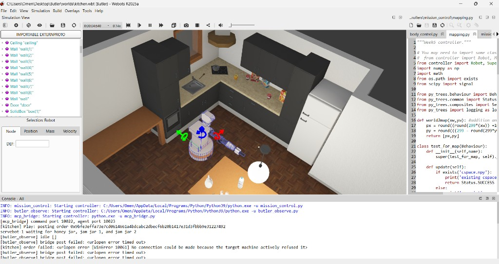
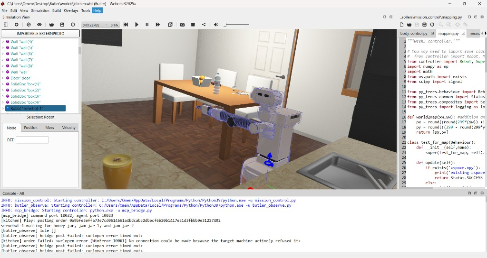
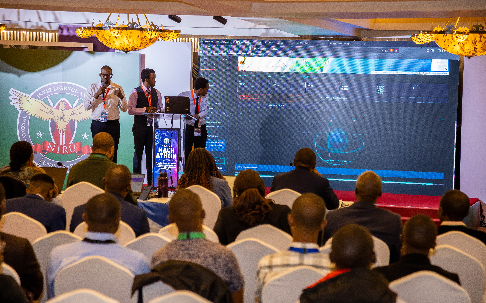
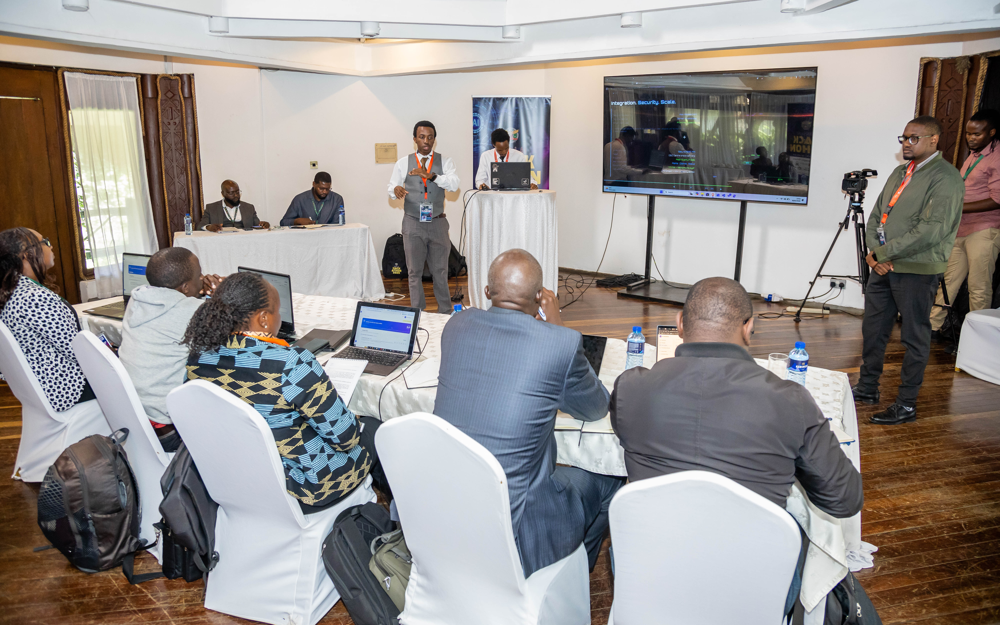
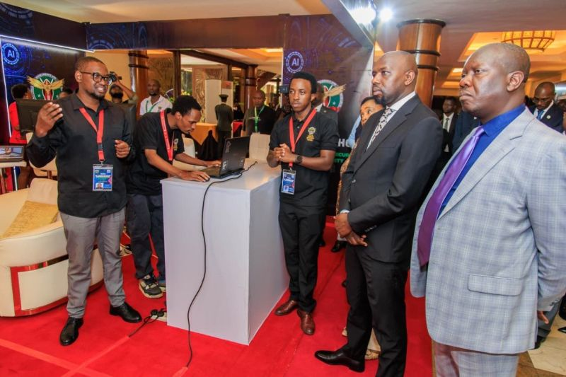
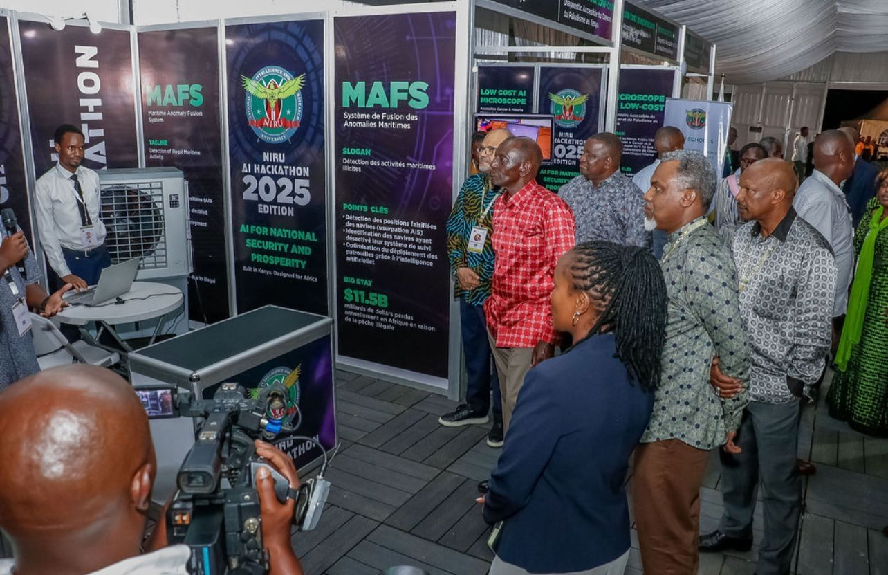

# Request for recognition and support

**To:** The organisers, ETHSafari

**From:** [Name], Bachelor of Business Information Technology (BBIT), Class of 2024, Africa Nazarene University; ETHSafari community member

**Date:** [Date]

**Contact:** [Email] · [Phone]

**Subject:** Letter of recognition for Butler — a hotel robot paid when the delivery is proved

Dear ETHSafari organisers,

I have been part of this community for a while. I have taken part in the ETHSafari hackathons, and I was at the first ETHSafari. I am writing as a member to ask for **only a short letter of recognition** stating that **Butler** is a Kenyan use of Web3 in a real trade. The letter should be one I can share with the hackathon programme organisers at **Canteen** (**arjun@thecanteenapp.com**). Please issue it from an **official ETHSafari email** with **arjun@thecanteenapp.com copied**.

Butler is a service robot in a hotel. A guest orders food or a drink. The robot collects it in the kitchen and leaves it at the room. Digital dollars are held until the order is on the table. The kitchen is paid at pickup. The rest is released at delivery, split between the operator, the maker, and a reserve for the robot. The robot has a public identity, so the receipt names a machine.

The first building is a hotel, because the job is easy to see: fetch, carry, deliver, get paid. The same rule can later cover other tasks in that building and in others. Today the hotel is a computer simulation. The demo is that service.

## The sector it sits in

In 2025 Kenya's tourism earnings were about KSh 0.5 trillion, from about 7.9 million tourists. Invest Kenya counts more than 900 accredited hotels and more than 45,000 rooms. The World Travel and Tourism Council's 2026 research says travel and tourism supported about 1.8 million jobs in Kenya in 2025, about 8.3 percent of employment.

On 27 September 2026, Cabinet Secretary Rebecca Miano said at World Tourism Day in Eldoret that travellers decide on a phone, and Kenya has to be present there. In February 2026, in Dubai, she said technology should send more of the income to the people who do the work. Butler is a graduate build in that direction, from a BBIT alumnus of Africa Nazarene University, class of 2024. A hotel task with a checkable receipt. This letter is my own request.

If a hotel agrees, the aims are a guest order that settles itself, a record of which robot did it, and a pattern for the next repeated task. The letter stays with those aims. The robot has not worked a real shift.

## Identity, payment, and the proof

What a visitor sees today is a simulation: kitchen, corridor, robot, table. peaq is the public record underneath. Circle, on a test network called Arc, is the digital-dollar rail.

The robot is named servebot-1 and already has a public identity. The guest's payment is held until delivery. Pickup pays the kitchen. Delivery releases the rest. A pickup and a delivery are already on the public record. A test payment to the kitchen counter has gone through. The guest's full hold, from lock to release, is still being completed. The demo screen will say which step is done. A guest in a real hotel would pay in ordinary money. The robot runs the delivery on its own. The record follows the proof.

## Why this belongs at a Safari

From the first Safari through the hackathons, the useful sessions have been the ones that show a working use. A hotel delivery whose payment and receipt can be checked is that kind of use. The demo I want, when you next confirm dates, is short. Three moments, with the simulation on screen:

- the order, and the guest's money held
- pickup, the kitchen paid, the record written
- the item on the table, and the rest of the payment released

Each moment labelled done-on-testnet or still being finished. A booth, if you have exhibition space, would show the same three moments to people walking past. Please consider that for the next confirmed edition, once the programme for that edition is published.

## Pictures and a clip you can judge now

*Caption: Simulation. The kitchen.*

*Caption: Simulation. Pickup.*

**[Image: the order on the table]**

*Caption: Simulation. Delivery.*

<video src="videos/one-delivery-order-to-table.mp4" controls width="100%"></video>

*Caption: One simulated job. Label: simulation.*

## What I have already shown

The path to Butler runs through work that is already on the record.

At the National Intelligence Research University (NIRU) National AI Hackathon, together with a team of two, I built a drone project, **Maritime Anomaly System**, and took it to a podium finish.

*Caption: Presenting the drone project on stage at the NIRU National AI Hackathon.*

*Caption: Presenting the drone project at the NIRU National AI Hackathon.*

In April 2026 we presented that drone project at the 3rd Mashariki Cooperation Conference in Diani, Kwale. The conference was hosted by the National Intelligence Service. Officials there included His Excellency Dr. William Samoei Ruto, C.G.H., President of the Republic of Kenya; Hon. Onesimus Kipchumba Murkomen, Cabinet Secretary for Interior and National Administration; and Mr. Noordin Mohamed Haji, Director-General of the National Intelligence Service. We presented the work to that audience.

*Caption: Presenting the project to Hon. Onesimus Kipchumba Murkomen, Cabinet Secretary for Interior and National Administration, and Mr. Noordin Mohamed Haji, Director-General of the National Intelligence Service.*

*Caption: Presenting the project to His Excellency Dr. William Samoei Ruto, C.G.H., President of the Republic of Kenya.*

I have taken **Maritime Anomaly System** through a national hackathon to a podium finish, explained it in a room of senior officials, and stayed with ETHSafari from the first edition through the hackathons. Butler is the build that follows that hackathon and those presentations. A real hotel comes only after a finished test payment and a willing property.

## What I am asking

1. A **short letter of recognition** on ETHSafari letterhead, stating that Butler is a real-world African use of Web3 (a hotel job, digital dollars, and a public work record) by a community member and BBIT graduate of Africa Nazarene University (Class of 2024), for me to share with **Canteen**, the hackathon programme organisers (**arjun@thecanteenapp.com**). Please issue it from an **official email** with **arjun@thecanteenapp.com copied**.

## Next step

A written reply, or a short call, is enough to agree the wording of the recognition letter. I can be reached at [Email] and [Phone].

Respectfully,

[Name]

Bachelor of Business Information Technology, Class of 2024

Africa Nazarene University

ETHSafari community member

## Sources

- Ministry of Tourism and Wildlife, 2 April 2026: about KSh 0.5 trillion in 2025 earnings; about 7.9 million tourists.
- Invest Kenya: more than 900 accredited hotels and more than 45,000 rooms.
- World Travel and Tourism Council, 2026: about 1.8 million jobs and about 8.3 percent of employment.
- Kenya News Agency and Capital FM, 27 September 2026: Cabinet Secretary Rebecca Miano, World Tourism Day.
- The Star, 5 February 2026: Cabinet Secretary Miano, World Governments Summit.
- ETHSafari, public notice, August 2026: the 2026 edition was postponed. This letter waits on the next dates.
